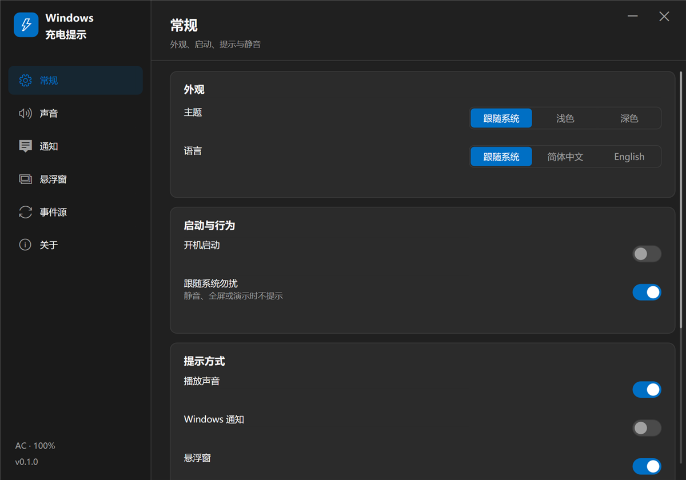

# Windows Charging Reminder / Windows 充电提示

此项目完全由AI完成，主要用于我自己学习和练习，功能只能说能用。如果你觉得这个应用确实能解决你的问题，也可以试试看。

This project is completely written by AI and is mainly used for my own learning and practice. The functionality is only usable. If you think this application can actually solve your problem, you can give it a try.

---

插拔充电器、电量低、电量充满、充电异常时给出提示。




## 现在能做什么

- 插电 / 拔电 / 充满 / 低电量 / 电量不足 / 充电异常
- 默认提示组合：**声音 + 悬浮窗开，Windows 通知关**
- 默认只启用插电、拔电两个**声音**；充满/低电/异常默认只保留悬浮窗提示，可在声音页单独打开
- 默认事件源启用 `GUID_ACDC` 回调 + 电池百分比回调，其余监听方式默认关闭
- 默认悬浮窗位置：**下方居中**
- 自绘 Direct2D 设置界面
  - 左侧栏：常规 / 声音 / 通知 / 悬浮窗 / 事件源 / 关于
  - 深色 / 浅色 / 跟随系统
  - PerMonitorV2 DPI，固定尺寸无白边
  - 跟随系统强调色
  - 滚动条可拖动，支持触控点击和拖动滚动
- 多语言
  - 跟随系统 / 简体中文 / English
  - 设置、托盘、通知、悬浮窗统一使用当前语言
- 悬浮窗
  - 270 × 78 DIP，更紧凑
  - 闪电图标 + 圆角小背景
  - 插电时背景使用选中的颜色，拔电时根据整体背景自动使用浅灰/深灰
  - 八个位置、0.5–10.0 秒、透明度、圆角、背景色
  - 设置页预览 + 桌面实际预览
- Windows 气泡通知
  - 内容可选“当前电量 / 阈值文案”
  - 通知声音：自动 / 始终开启 / 始终关闭
  - 自动：应用声音开启时通知静音，应用声音关闭时使用系统通知声
- 暂时静音
  - 托盘菜单：1 / 2 / 4 / 8 小时，自定义时间
  - 设置页支持小时 + 分钟两个输入框，带加减按钮，范围 0–99 小时 59 分钟
  - 跟随系统勿扰/全屏/演示
- 事件源诊断
  - 可单独启用回调 / 广播 / 窗口兜底 / 电池回调 / 轮询
  - “全部启用（测试）”“采用最佳”“恢复默认”
  - 实时显示最近事件和各源计数
- 开机启动（HKCU Run，启动到托盘）
- 单实例；第二次启动会打开已有实例的设置
- 电池图标已嵌入 exe，托盘和窗口共用
- 配置文件、文件日志、导出日志
- x64 和 ARM64 两个原生构建，只依赖系统 DLL
- 产物文件名带软件名、版本号和架构；版本信息显示为 “Windows Charging Reminder”
- 充电异常默认：插电后 10 分钟内相对插入时下降 3%

## 还没做

- 自定义音频非 WAV 的自动转换（当前只接受 WAV）
- 多套音频预设的切换/新建/删除
- 即时音频模式（保持音频设备常开）
- 悬浮窗模糊
- 真正的 Windows Toast（当前是托盘气泡）
- 设置窗口缩放（当前固定尺寸，为了去掉系统白边）

## 构建

需要 MSYS2：

- x64：`D:\Applications\msys2\ucrt64\bin\g++.exe`、`windres.exe`
- ARM64：`D:\Applications\msys2\clangarm64\bin\clang++.exe`、`windres.exe`

在项目根目录：

```powershell
powershell -NoProfile -ExecutionPolicy Bypass -File .\build.ps1 -Arch x64
powershell -NoProfile -ExecutionPolicy Bypass -File .\build.ps1 -Arch arm64
```

资源（图标 + manifest）由 `build.ps1` 自动通过 `windres` 编译：

```text
src/app.rc
src/app.manifest
src/res/app.ico
```

产物：

```text
dist\WindowsChargingReminder-0.1.0-x64.exe
dist\WindowsChargingReminder-0.1.0-arm64.exe
```

两个都是静态链接的单个 exe，导入表里只有系统 DLL。

## 运行

```powershell
.\run.cmd
```

`run.cmd` 会根据当前进程架构自动选择 x64 / ARM64。

直接启动会打开设置窗口；开机启动带 `--tray`，只进托盘。

```powershell
.\dist\WindowsChargingReminder-0.1.0-arm64.exe --tray --quit-after 5
```

托盘右键菜单：

- 设置
- 静音：1 / 2 / 4 / 8 小时、自定义时间、取消静音
- 开机启动
- 打开配置文件
- 打开日志文件夹
- 退出

左键双击托盘图标打开设置。关闭设置窗口只隐藏到托盘。

## 配置

```text
%APPDATA%\WindowsChargingReminder\config.ini
```

UTF-16 LE，可直接用记事本编辑。

| 段 | 字段 | 默认 | 说明 |
|---|---|---|---|
| General | StartWithWindows | 0 | 开机启动 |
| General | Theme | system | system / light / dark |
| General | Language | system | system / zh-CN / en-US |
| General | MuteUntil | 0 | Unix 时间戳，静音截止 |
| General | FollowDoNotDisturb | 1 | 跟随系统勿扰/全屏/演示 |
| Detect | PollMs | 500 | 轮询间隔，100–5000 |
| Detect | UseCallback | 1 | GUID_ACDC 回调 |
| Detect | UseBroadcast | 0 | PBT_APMPOWERSTATUSCHANGE |
| Detect | UseWindowFallback | 0 | 回调失败时使用窗口消息 |
| Detect | UseBatteryPercent | 1 | 电池百分比回调 |
| Detect | UsePoll | 0 | 轮询兜底 |
| Events | Plug/Unplug/Full/Low/Critical/Abnormal | 1 | 事件总开关 |
| Thresholds | Full / Low / Critical | 100 / 20 / 10 | 百分比 |
| Thresholds | AbnormalWindowMinutes / AbnormalDrop | 10 / 3 | 10 分钟内掉 3% |
| Sound | Enabled | 1 | 声音总开关 |
| Sound | PlugEnabled / UnplugEnabled | 1 / 1 | 插拔声音 |
| Sound | FullEnabled / LowEnabled / CriticalEnabled / AbnormalEnabled | 0 | 其他事件声音默认关 |
| Sound | MasterVolume | 80 | 0–100 |
| Sound | PlugFile 等 | 空 | 空表示用系统默认音 |
| Notify | Enabled | 0 | 气泡通知 |
| Notify | SoundMode | auto | auto / on / off |
| Overlay | Enabled | 1 | 悬浮窗 |
| Overlay | Position | bottom-center | 八种位置 |
| Overlay | DurationMs / Opacity / CornerRadius | 3000 / 95 / 12 | 时长/透明度/圆角 |
| Overlay | Background / IconColor | system / system | 颜色方案 |

> 默认监听 `GUID_ACDC` 回调 + 电池百分比回调。充满 / 低电 / 充电异常依赖电量百分比变化；如果关闭电池回调，需要另外开启轮询。

## 日志

```text
%LOCALAPPDATA%\WindowsChargingReminder\logs\app.log
```

每次启动、事件、静音、开机启动、错误都会记录。超过 2MB 轮转为 `app.log.1`。

“关于”页可以把当前日志和配置导出到桌面新文件夹。

## 代码结构

```text
src/
  main.cpp        入口、单实例、命令行
  app.*           窗口过程、托盘命令、事件分发
  power.*         事件源 + 状态机
  audio.*         WAV + WASAPI
  tray.*          托盘、菜单、气泡
  config.*        INI 读写
  strings.*       中英文文案表
  log.* / util.*  日志、路径、DPI、主题
  ui/
    ui.*          Direct2D 控件
    settings.*    设置窗口
    overlay.*     悬浮窗
    overlay_style.*  悬浮窗配色
  app.rc / app.manifest / res/app.ico

tools/probe/      开发期的电源事件探针
docs/             README 截图
VERSION           版本号，build.ps1 用它命名产物
build.ps1         编译 x64 / ARM64
run.cmd           按当前架构启动
```

## 已验证

- x64 和 ARM64 均能编译、启动、退出
- 设置界面六个页面、深浅色、语言切换、下拉框、滚动
- 悬浮窗 270×78、闪电图标、插拔配色、下方居中
- 事件源默认回调 + 电池百分比回调
- 声音默认只开插拔
- 静音小时/分钟输入（2 小时 30 分钟实际生效）
- 白边通过去掉 `WS_THICKFRAME` 解决（固定尺寸）
- 触控 `WM_TOUCH` 坐标已修正，待实机复测
- 默认 WAV 播放正常

## 下一步

1. Media Foundation 导入 MP3 / M4A / FLAC
2. 多套音频预设
3. 即时音频模式
4. 悬浮窗模糊
5. 真正的 Windows Toast
